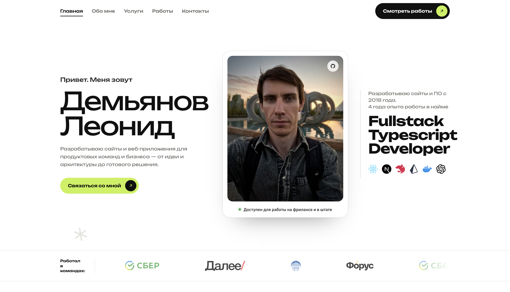

# SWP Freelancer Portfolio

A fast, accessible Astro portfolio theme for freelance art directors, designers
and small studios. Case studies, services and contact details —
built as static HTML with a few kilobytes of vanilla JavaScript and no UI
framework.



## Demo

**https://swp-freelancer-portfolio.vercel.app/**

Source: [github.com/Scintillaweb/swp-freelancer-portfolio](https://github.com/Scintillaweb/swp-freelancer-portfolio)

## Features

- **Astro 7, static output.** Every route is prerendered. No adapter, no server.
- **No UI framework.** Astro components, plain CSS, and roughly 5 KB of vanilla
  JavaScript on the heaviest page — about 2 KB over the wire.
- **Static routes** for home, about, services, work, contact, privacy, terms
  and a custom 404 — plus `robots.txt` and a sitemap.
- **Content collections** for projects and services, with typed frontmatter
  schemas and draft support; one separate article template remains dormant.
- **One config file.** Name, role, contact details, social links and SEO
  defaults all live in `src/config/site.ts`.
- **Case studies** with results figures, client facts, services, tooling and a
  next-project link.
- **Filterable work grid** built from the categories actually in use, with an
  `aria-live` result count.
- **Accessible by construction** — skip link, visible focus rings, a
  keyboard-operable nav drawer, one `h1` per page and
  a palette checked against WCAG AA.
- **Works without JavaScript.** Content renders, and the mobile drawer
  degrades to a plain visible list.
- **Respects `prefers-reduced-motion`.** The reveal animation is opt-in under
  `prefers-reduced-motion: no-preference`, so it can never leave content stuck
  invisible.
- **Self-hosted variable fonts.** Local Unbounded and IBM Plex Sans files cover every weight; no request
  leaves your domain.
- **Custom SVG throughout** — a 27-icon sprite, three project artworks, two
  device mockups, a signature mark and the monogram behind the favicon and app
  icons. No icon library. Header and footer take raster logo files, swappable
  in one config block.
- **SEO built in** — canonical URLs, Open Graph, Twitter cards, JSON-LD
  (`Person`, `WebSite`, `BreadcrumbList`), a generated sitemap
  and a generated `robots.txt`.

## Tech stack

| | |
| --- | --- |
| Framework | [Astro](https://astro.build) 7.3 |
| Language | TypeScript (strict) |
| Styling | Plain CSS with custom properties — no preprocessor, no utility framework |
| Content | Astro content collections (Markdown) |
| Integrations | `@astrojs/sitemap` |
| Tooling | `@astrojs/check` for type checking |

Five dependencies in total. Nothing else is installed.

## Requirements

- **Node.js 22.12 or newer** — Astro 7's floor. Node **22.19+** or **24+** is
  recommended, because some transitive dependencies declare 22.19 as theirs and
  npm will warn otherwise.
- npm 9.6.5 or newer (pnpm, yarn and bun work too).

## Installation

```bash
git clone https://github.com/Scintillaweb/swp-freelancer-portfolio.git
cd swp-freelancer-portfolio
npm install
```

## Development

```bash
npm run dev        # http://localhost:4321
```

## Build

```bash
npm run build      # static output in dist/
```

## Preview

```bash
npm run preview    # serve the built site locally
```

## Other scripts

```bash
npm run check      # astro check — TypeScript and template diagnostics
npm run sync       # regenerate content collection types
```

## Project structure

```
├── astro.config.mjs        # site URL, trailing slashes, sitemap
├── public/
│   ├── fonts/              # self-hosted WOFF2 + OFL licence texts
│   ├── images/             # optimised WebP photographs
│   ├── favicon.svg         # monogram
│   ├── og-default.png      # fallback social card
│   └── site.webmanifest
└── src/
    ├── config/site.ts      # ← start here
    ├── content.config.ts   # collection schemas
    ├── types.ts            # types for the data files
    ├── content/
    │   ├── projects/       # case studies (Markdown)
    │   ├── services/       # service pages (Markdown)
    │   └── blog/           # one dormant article template; no blog routes
    ├── data/               # everything that is a list, not a page
    ├── layouts/
    │   ├── BaseLayout.astro    # <head>, header, footer, global scripts
    │   └── PageLayout.astro    # BaseLayout + a standard page header
    ├── components/
    │   ├── home/           # one component per homepage section
    │   ├── cards/          # work, post, service cards
    │   ├── art/            # inline SVG artwork
    │   ├── icons/          # the icon sprite
    │   └── *.astro         # Header, Footer, Button, Seo, ContactForm …
    ├── lib/                # date helpers, JSON-LD builders
    ├── pages/              # routes
    └── styles/
        ├── global.css      # imports the five layers below
        ├── fonts.css       # @font-face
        ├── tokens.css      # ← colours, type, spacing, radii
        ├── base.css        # reset, base elements, type scale
        ├── components.css  # buttons, chips, section headings, reveal
        ├── sections.css    # the sixteen homepage sections
        └── pages.css       # inner-page styles (case study, prose, form …)
```

### Where content lives, and why there are two places

Projects and services are Markdown files in `src/content/`, validated by the
schemas in `src/content.config.ts`. `src/content/blog/` contains one dormant
article template; no page or route currently renders a blog.

Short repeating things that never get their own page — **navigation, the
toolkit grid, client logos and stats** — are typed TypeScript arrays in `src/data/`. They are easier to
edit and reorder than a directory of two-line Markdown files.

## Customisation

### Site information

Open **`src/config/site.ts`**. It holds the name, the person, the role, the
description, the email, the phone number, the location, the availability line,
the social links, the footer blurb, the copyright holder, the theme colour and
the default social image. Change it and the header, footer, hero, contact page,
metadata, structured data and sitemap all follow.

### Site URL

Set `site` in **`astro.config.mjs`** — it feeds canonical URLs, Open Graph tags,
the sitemap and `robots.txt`. You can also override it per build:

```bash
SITE_URL=https://example.com npm run build
```

### Colours and typography

Everything visual is a custom property in **`src/styles/tokens.css`**:

```css
--swp-lime       /* accent            */
--swp-lime-deep  /* accent, hover     */
--swp-ink        /* near-black        */
--swp-graphite   /* dark band         */
--swp-slate      /* secondary text    */
--swp-mist       /* tinted surface    */
--swp-line       /* borders           */
--swp-shell      /* page background   */
--swp-faint      /* faded client logos */
--font-display   /* headings, buttons */
--font-body      /* everything else   */
--pad --shell    /* gutter, max width */
--r-sm … --r-pill /* radii            */
--sec            /* section rhythm    */
```

Recolouring the theme is a matter of changing the first eight values. If you do,
check your new pairings against WCAG AA — the shipped palette passes 4.5:1 for
body text and 3:1 for large text and focus rings.

To change the typefaces, drop your WOFF2 files in `public/fonts/`, rewrite the
`@font-face` blocks in `src/styles/fonts.css`, update the two `--font-*` tokens,
and update the two `<link rel="preload">` tags in
`src/layouts/BaseLayout.astro`.

### Favicon

`public/favicon.svg` is an inline SVG monogram, also available as
`#i-logo` in the icon sprite. If you change it, regenerate
`apple-touch-icon.png`, `icon-192.png` and `icon-512.png` to match.

### Navigation

**`src/data/navigation.ts`** holds three lists: `primaryNav` (header and
drawer), `mobileExtraNav` (extra drawer links) and `footerNav`. Write hrefs
with a trailing slash — the site is built with `trailingSlash: 'always'`.

A `primaryNav` entry may carry an `anchor`. On the homepage that link scrolls to
the section instead of navigating away; on every other page it uses the real
URL.

### Homepage sections

`src/pages/index.astro` lists the homepage components. Reorder them, or
delete the ones you do not want:

```astro
<Hero /> <TrustedStrip /> <Collaborate /> <StatsBand /> <About />
<Services /> <Toolkit /> <Work />
```

The copy for the one-of-a-kind sections (hero, collaborate, about, CTA and the
section headings) lives in `src/data/highlights.ts`.

#### The "Working together" visuals

That section shows a staggered pair of images, set in `collaborate.images` in
`src/data/highlights.ts`. The images are specific to this portfolio; replace
them only with images you have permission to use.

`.mock img` and `.mock svg` share the same sizing rules, so either works
without touching the CSS.

Both slots are `aspect-ratio: 1 / 1`, which keeps the two images the same
height — the staggered look comes from `margin-top` on `.mock-a` and
`margin-bottom` on `.mock-b`, not from differing shapes. Change the ratio in
`src/styles/sections.css` if your images suit a different one; the bundled
mockups were drawn on a 4/5 canvas.

### The other data files

| File | Controls |
| --- | --- |
| `src/data/clients.ts` | Marquee logos and the strip's label |
| `src/data/stats.ts` | The three approach cards and the band headline |
| `src/data/toolkit.ts` | The toolkit grid |

Each is a typed array; the types are in `src/types.ts`, so your editor will tell
you when a field is missing.

## Adding a project

Create `src/content/projects/my-project.md`. The filename becomes the URL:
`/work/my-project/`.

```markdown
---
title: Project name
client: Client name
year: '2026'
category: Product          # Product | Brand | Web
excerpt: One line, shown on the card
description: One or two sentences, used as the meta description
image:
  src: /images/my-project.webp
  alt: A real description of what the photograph shows
  width: 900
  height: 675
services: ['Interface design', 'Design system']
technologies: ['Figma', 'Design tokens']
results:
  - value: '+44%'
    label: What that number measures
externalUrl: https://example.com   # optional, adds a "Visit the site" button
featured: true             # true puts it on the homepage
order: 1                   # lower sorts first
draft: false               # drafts are visible in dev, excluded from builds
---

## A heading

The body is ordinary Markdown and renders into the case-study column.
```

Put the image in `public/images/` and give `width` and `height` its real pixel
dimensions — they reserve the space and stop the layout shifting.

**Categories.** The filter chips on `/work` are generated from the categories in
use, so you only need to widen the `category` enum in `src/content.config.ts` to
add one.

## Adding a service

Create `src/content/services/my-service.md` → `/services/my-service/`.

```markdown
---
title: Service name
icon: layers               # any id from the icon sprite
number: S/07               # the label in the card corner
excerpt: One or two lines, shown on the card
description: Used as the meta description
tags: ['Flows', 'States']
features:
  - Listed under "What is included"
process:
  - title: Frame
    body: Shown in the sidebar under "How it runs"
ctaLabel: Ask for a scope
order: 7
draft: false
---

Markdown body.
```

The footer lists the first five services automatically.

## Contact form

The form at `/contact/` submits to [Web3Forms](https://web3forms.com). It stays
disabled until a Web3Forms access key is available at build time.

1. Create a form in Web3Forms and copy its access key.
2. For local development, copy `.env.example` to `.env` and set
   `PUBLIC_WEB3FORMS_ACCESS_KEY` to that key.
3. For a deployed build, provide the same variable in the build environment.
   If GitHub Actions builds the site, add it to the repository's Actions
   variables or secrets and expose it to the build step.

The `PUBLIC_` prefix means the access key is included in the generated site and
visible to visitors. Web3Forms keys are intended for this browser-side use; do
not use this pattern for passwords or private API credentials. The form sends
`name`, `email`, `company`, `project_type` and `message`, with Web3Forms' hidden
`botcheck` honeypot. `.env` is ignored by Git and the example file contains no
key.

## Deployment

The build is plain static files in `dist/`. Set `site` in `astro.config.mjs`
first, then:

**Vercel** — import the repository. Framework preset: Astro. Build
`npm run build`, output `dist`. No adapter needed.

**Netlify** — build `npm run build`, publish directory `dist`.

**Cloudflare Pages** — framework preset Astro, build `npm run build`, output
`dist`. Set `NODE_VERSION` to `22` or higher in the environment variables.

**GitHub Pages** — use the official
[`withastro/action`](https://github.com/withastro/action). For a *project*
page served from a subpath, also set `base` in `astro.config.mjs`:

```js
site: 'https://your-username.github.io',
base: '/swp-freelancer-portfolio',
```

**Any static host** — upload `dist/`. The site needs no server runtime. Point
your 404 handler at `/404.html`; Netlify, Vercel, Cloudflare Pages and GitHub
Pages all do this automatically.

## Images

Portfolio photographs and images are stored locally in `public/photo/` and
`public/images/`; project documents are in `public/docs/`. They are included to
present this portfolio and are not covered by the source-code MIT licence.
Do not copy or reuse them without written permission from the relevant rights
holder. See [CREDITS.md](CREDITS.md) for details and third-party licences.
fold. Because they are already the right size and format, the theme uses plain
`` rather than `astro:assets` — that keeps `sharp` out of the dependency
tree and the build fast. If you would rather use Astro's image pipeline, move
the files to `src/assets/`, import them, and swap the `` tags for
`<Image>`.

Give every meaningful image real alt text. Use `alt=""` only for images that
are purely decorative.

## Icons and SVG

All the artwork is custom and inline. There is no icon library.

The 27-icon sprite is rendered once per page from
`src/components/icons/IconSprite.astro` and referenced through a small
component:

```astro
<Icon name="arrow" class="ic-sm" />
<Icon name="mail" label="Email" />   <!-- labelled, so it is exposed to AT -->
```

Without a `label`, an icon is `aria-hidden` — correct for decoration beside
text. Every icon inherits `currentColor`, so the same symbol works on light and
dark surfaces.

To add one, drop a `<g id="i-yourname">` into the sprite on a 24×24 viewBox and
add the name to `IconName` in `src/types.ts`.

## Accessibility

What the theme does, so you know what not to undo:

- A skip link, and `<main id="main">` for it to reach.
- Visible `:focus-visible` rings on every interactive element, switching to
  lime on dark surfaces. Nothing uses `outline: none`.
- The nav drawer has `aria-expanded`, `aria-controls`, Escape-to-close, focus
  moved in on open and returned to the trigger on close — and without
  JavaScript it degrades to a plain visible list.
- One `h1` per page, no skipped heading levels, landmarks on every nav.
- `aria-current="page"` only on exact matches; ancestor sections are styled
  through a class instead, so the attribute never lies.
- The work filter announces its result count through an `aria-live` region.
- Every form field has a real `<label>`; hints are wired up with
  `aria-describedby`.
- A palette verified at 4.5:1 for body text and 3:1 for large text.
- `prefers-reduced-motion: reduce` disables the reveal, the marquee, the pulse
  and the rotating mark, and the count-up renders its final value immediately.

If you change the palette or the markup, re-check these.

## Performance

- Static HTML, no hydration, no framework runtime.
- Roughly 5 KB of JavaScript on the homepage (about 2 KB gzipped), and less on
  every other page. It is split across five small scripts — scroll reveal and
  header state, the nav drawer, the marquee, the stat counters,
  and the work filter — each shipped only to the pages that use it. Every one
  of them is an enhancement over markup that already works.
- One ~38 KB stylesheet (8 KB gzipped), one inline icon sprite, a 3 KB logo,
  and two local fonts with Cyrillic support.
- Images pre-sized, WebP, dimensioned and lazy-loaded below the fold; only the
  hero portrait is `fetchpriority="high"`.
- No third-party requests at all. No analytics, no font CDN and no embeds.

## Browser support

Current versions of Chrome, Edge, Firefox and Safari.

The theme leans on a few modern CSS features and degrades cleanly where they
are missing, including `aspect-ratio` and `clamp()`.

## License

The website source code is licensed under MIT; see [LICENSE](LICENSE). The
licence does not apply to the portfolio's photographs, written materials,
project images, documents, or third-party assets. Their use is restricted as
described in [CREDITS.md](CREDITS.md).

## Credits

- [Astro](https://astro.build) — framework
- [Lucide](https://github.com/lucide-icons/lucide) — handshake icon
- [Unbounded](https://github.com/google/fonts/tree/main/ofl/unbounded) and [IBM Plex Sans](https://github.com/google/fonts/tree/main/ofl/ibmplexsans) — fonts

See [CREDITS.md](CREDITS.md) for licence details and portfolio asset restrictions.

## Contributing

Issues and pull requests are welcome. Before opening a PR, please run:

```bash
npm run check && npm run build
```
